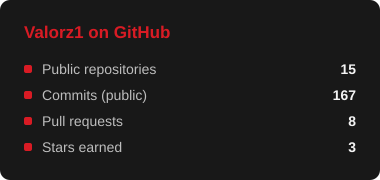
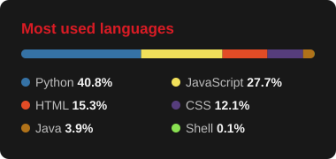

### Hey, I'm Parmbir! 👋

**Second-year BSc Computer Science (AI) student at Brunel University of London**

I build useful software, dig into how systems break, and make things work better, whether that's a phishing analyser, a local AI assistant or a robot.

  

---

## 👨‍💻 About me

I learn by turning an idea into something that can be tested and used. My interests sit where **software engineering, cybersecurity and applied AI** overlap.

- 🎯 **Seeking:** A 12-month placement from **summer 2027** in software engineering, AI or cybersecurity.
- 💼 **Experience:** Information security internship at **SCS Railways (HS2 London Tunnels)**, working with Microsoft Entra ID and Defender.
- 🔐 **Interested in:** Application security, backend systems, identity, local AI and practical ML.
- 🏆 **Proud of:** Microsoft recognition for our team's design and creativity at the **Hillingdon × Brunel Hackathon 2026**.
- 🤝 **Community:** PAL Leader, and Co-founder and Treasurer of Brunel's Cyber Security Society.
- 🏔️ **Away from my desk:** A mountain view beats another window full of tabs.

## 🚀 Featured projects

A selection of things I've designed, built or worked on, on my own and in teams.

| Project | What it does | Stack / focus |
| --- | --- | --- |
| 🛡️ **[HookLine](https://github.com/Valorz1/hookline)** | Analyses phishing emails using authentication checks, suspicious link and attachment indicators, and explainable verdicts. | `Python` `Flask` `VirusTotal` `Email Security` |
| 📚 **[The Archive](https://github.com/Valorz1/rag-chatbot)** | Local-first document Q&A with source citations, conversational retrieval and local inference with Ollama. | `Python` `FastAPI` `LlamaIndex` `ChromaDB` `Ollama` |
| 💷 **[NetValor](https://github.com/Valorz1/NetValor)** · *In development* | A UK personal finance learning platform with an AI assistant grounded in educational content. | `Next.js` `TypeScript` `FastAPI` `LangChain` |
| 🏙️ **[Hillingdon ReportHub](https://github.com/Valorz1/Hillingdon-ReportHub)** | A council issue reporting and triage platform from a team hackathon; recognised by Microsoft. | `UI/UX` `Python` `Web Apps` `Teamwork` |
| 🐛 **[UK Tick Tracker](https://github.com/Valorz1/uk-tick-tracker-backend)** | Backend for ingesting, cleaning, searching and reporting UK tick-sighting data, supported by automated tests. | `Python` `FastAPI` `SQLite` `pytest` |
| 🤖 **Spybot** | A Raspberry Pi SwiftBot application that delivers Morse-code messages, backed by requirements and hardware testing. | `Java` `JUnit` `Maven` `Raspberry Pi` |
| 🌐 **[Brunel Cyber Security Society](https://brunelcs.org)** | Designed a responsive society website in Figma and collaborated with the committee on implementation. | `Figma` `UI/UX` `Responsive Design` |

**[Visit my portfolio →](https://valorz1.github.io/my-portfolio/)** · **[Portfolio source →](https://github.com/Valorz1/my-portfolio)** · **[Browse all repositories →](https://github.com/Valorz1?tab=repositories)**

## 🧰 Technical toolkit

**Languages**

**Frameworks, backend and databases**

**AI / retrieval**

**Tools and hardware**

## 🏆 Beyond the code

**Information security intern · SCS Railways, HS2 London Tunnels**  
Supported a passwordless authentication rollout for approximately **1,000 staff**, covering documentation, user communications and troubleshooting. Worked with Microsoft Entra ID and Defender on security-related tasks.

**Hillingdon × Brunel Hackathon 2026**  
Worked in a team of four on **ReportHub**, which helps residents submit local issues and routes them to the right council teams. I led the UI/UX work, presented with the team and we received **Microsoft recognition** for innovative design and creativity. I later revisited the project to improve its implementation.

**Leadership and community**  
I support student learning as a **PAL Leader** and help run the university's cybersecurity community as **Co-founder and Treasurer** of the Cyber Security Society.

## 🌱 Currently exploring

- Making **HookLine** more robust and useful for phishing analysis.
- Building **NetValor**, including its FastAPI backend and AI-assisted learning experience.
- Improving local-first RAG workflows and testing retrieval quality.
- Deepening my skills in **C++, Docker, CI/CD and cloud fundamentals**.
- Revisiting older projects with better testing, accessibility and maintainability.

## 📈 GitHub at a glance

---

### Let's build something useful.

I'm open to connecting with developers, collaborating on interesting ideas, and discussing **placement opportunities for summer 2027**.

*Thanks for stopping by! ✨*

